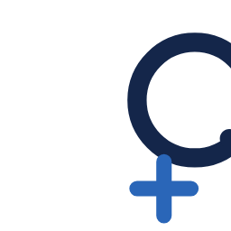

# Q+U website

<p align="center"></p>

The public site for Q+U, served by GitHub Pages at **https://qplusu.github.io/** when the repository is public.

A single static page: `index.html`, one stylesheet, two canvas scripts, a handful of images. No build step. Edit, commit, push; Pages redeploys in about a minute.

```
index.html          the page
src/styles.css      tokens, layout, components, light and dark themes
src/radar.js        hero: the 3D sequencing disc
src/wave.js         contact section: the particle wave with the hoop
assets/logo-mark.svg
assets/brand/       downloadable mark (SVG, PNG 256 / 512 / 1024)
assets/team/        founder photos (800 x 800, grey background)
assets/galaxy.jpg   backdrop, 2600 px wide
.nojekyll           tells Pages to serve the files as they are
```

---

## Colour

Two themes, switched by the toggle in the nav. The theme follows the system preference, falls back to light by day and dark by night, and remembers a manual toggle for the session. All colours are custom properties on `:root`; components never hard-code a colour.

### Dark

| Token | Value | Use |
|---|---|---|
| `--bg` | `#0B1426` | page ground, deep navy |
| `--bg-2` | `#101B33` | stats band, card fill |
| `--fg` | `#F2ECE1` | text, cream |
| `--fg-soft` | `#A9B4C8` | secondary text, captions |
| `--accent` | `#5B9BFF` | links, labels, migrated systems, the sweep |
| `--accent-ink` | `#0B1426` | text on accent |
| `--cta` / `--cta-ink` | `#F2ECE1` / `#0B1426` | primary button |
| `--line` | `rgba(242,236,225,0.16)` | rules and borders |
| `--line-strong` | `rgba(242,236,225,0.55)` | secondary button border |
| `--pill` | `rgba(11,20,38,0.6)` | nav pill, blurred |
| `--ring-a` / `--ring-b` | `91,155,255` / `242,236,225` | canvas: post-quantum / vulnerable |

### Light

| Token | Value | Use |
|---|---|---|
| `--bg` | `#F2ECE1` | page ground, paper |
| `--bg-2` | `#EAE2D4` | stats band, card fill |
| `--fg` | `#14264A` | text, navy |
| `--fg-soft` | `#4A5A78` | secondary text |
| `--accent` | `#2A66B8` | links, labels, the sweep |
| `--accent-ink` | `#FFFFFF` | text on accent |
| `--cta` / `--cta-ink` | `#14264A` / `#F2ECE1` | primary button |
| `--line` | `rgba(20,38,74,0.22)` | rules and borders |
| `--line-strong` | `#14264A` | secondary button border |
| `--pill` | `rgba(242,236,225,0.72)` | nav pill |
| `--ring-a` / `--ring-b` | `42,102,184` / `20,38,74` | canvas colours |

The navy and the blue come from the logo. Cream is the paper from the earlier version of the site and the lettering colour on dark. Nothing else is used: no greys outside the tokens, no gradients except the soft accent glow behind the hero and the halo on the disc.

### The galaxy

`assets/galaxy.jpg` sits fixed behind the whole page. In dark it is screen-blended at 60% and fades toward the bottom of the viewport; in light it is inverted, desaturated and multiplied at 14%, so the stars read as ink specks on paper. It dims to 25% once the reader scrolls past the hero. Content sections sit on a translucent ground (86% of `--bg`) so text stays readable; the hero and "Our insight" are left clear so the universe shows through.

Photo: the Artemis II crew, NASA, April 9, 2026. Credited in the footer.

---

## Type

**Instrument Sans** from Google Fonts, weights 400 to 700. Fallbacks: Be Vietnam Pro, Helvetica Neue, Arial.

| Token | Size | Use |
|---|---|---|
| `--fs-0` | 13px | uppercase labels, eyebrows, stat captions |
| `--fs-1` | 15px | fine print, card body, mono roles |
| `--fs-2` | 18px | body, table text |
| `--fs-3` | 25.6px | section headings |
| `--fs-display` | 2.6rem to 5.4rem, fluid | hero headline |

Headlines are weight 600 with tight tracking (−0.02em to −0.035em) and line-height near 1. Uppercase labels are tracked out (+0.12em to +0.16em). Body measures are capped at 64ch. Founder roles are set in the system monospace, uppercase, tracked.

---

## Layout

The page is one column of full-width bands, each with its content in a centred wrap of 1240px and 24px side gutters (16px on phones).

```
┌──────────────────────────────────────────────────────┐
│ [Q+U]              ( Problem Insight … Talk to us ☾ ) │  fixed pill nav
├──────────────────────────────────────────────────────┤
│  HELPING YOU MIGRATE…        ┌──────────────────┐   │
│  Post-quantum readiness,     │   3D disc canvas  │   │  hero: 11 / 9 grid
│  made knowable.              │                  │   │  min 100svh, max 900px
│  [Talk to us] [See scanner]  └──────────────────┘   │
│  universe / known unknown      EXPOSURE 42%  ■ ■     │
├──────────────┬──────────────┬────────────────────────┤
│  2030        │  5%          │  62%                   │  stats band, 3 columns
├──────────────┴──────────────┴────────────────────────┤
│  The problem       │  lead sentence                  │  section: 300px sticky
│  WHERE ORGS STAND  │  evidence table                 │  label column + body
├────────────────────┼─────────────────────────────────┤
│  Our insight       │  lead + three cards             │  galaxy visible
├────────────────────┼─────────────────────────────────┤
│  Scanner           │  Discovery → Scanning →         │
│                    │  Analysis → Reporting           │
├────────────────────┼─────────────────────────────────┤
│  Why now           │  two paragraphs                 │
├────────────────────┼─────────────────────────────────┤
│  Founders          │  three photo cards              │
├────────────────────┴─────────────────────────────────┤
│                  Let's talk.  [GitHub] [Issue]       │  centred call to action
│              ~~~ particle wave with hoop ~~~         │
├──────────────────────────────────────────────────────┤
│  principle  ·  © 2026 Q+U · source · logo downloads   │  footer
│  NASA credit and the unknown / known-unknown line     │
└──────────────────────────────────────────────────────┘
```

Below 900px the hero stacks (text, then the disc), section labels move above their body, the stats stack, the nav collapses to the call to action, a menu button and the theme toggle, and the wave key and scroll hint hide.

### Components

- **Pill nav.** Fixed, blurred, 12px radius. Links, a solid call-to-action chip, and the sun/moon toggle.
- **Section.** `h2` plus a small uppercase sub-caption, sticky at 96px on desktop. Body starts with a `.lead` sentence at 1.25 to 1.65rem.
- **Cards.** 14px radius, 1px `--line` border, `--bg-2` fill. Linked cards lift 3px and turn their border accent on hover. Founder cards carry an 800px square photo, shown in black and white, with the name, an "in" LinkedIn mark and the role in mono caps.
- **Tables (`table.spec`).** Ruled rows, uppercase heading column at 30% width, body text in `--fg`.
- **Buttons.** 8px radius, uppercase 13px tracked. `.solid` uses `--cta`, the outline uses `--line-strong`; both turn accent on hover.
- **Stages strip (`ol.stages`).** Bold words joined by accent arrows.
- **Callout.** Thin border with a 3px accent left edge.

### Motion

- **Hero disc (`radar.js`).** A 3D disc drawn on canvas in the two ring colours, turning slowly and tilting with the pointer. Cycle: 16 s.
- **Wave (`wave.js`).** A particle wave with a hoop, in the same two colours. Cycle: 18 s.
- **Telescope lens.** A 180px circle follows the pointer and shows the galaxy at full strength, magnified. Hidden on touch screens.
- **Reveal.** Section bodies fade up 18px on first scroll into view.

Both canvases pause when scrolled off screen. Under `prefers-reduced-motion` every animation is replaced by a still frame and the lens is removed.

---

## Review switches

Append to the URL:

| Query | Effect |
|---|---|
| `?theme=dark` / `?theme=light` | force a theme |
| `?t=7000` | jump both animations to that millisecond |
| `?lens=520,430` | pin the telescope lens at those viewport coordinates |

They combine: `?theme=dark&t=7000&lens=520,430`.

## Editing

- Colours and sizes: change the tokens at the top of `src/styles.css`; everything follows.
- Copy: edit `index.html` directly.
- Cache: the three `?v=` suffixes on the stylesheet and scripts in `index.html` are bumped by hand when those files change.
- Photos: 800 x 800 JPEG on grey `#DCDAD4`, head near the top edge, face about 38% of the frame height. The site renders them in black and white.
- Logo: `assets/brand/` holds the mark as SVG and transparent PNGs. Linked from the footer for download.

## Credits

Background photo: the Artemis II crew, NASA, April 9, 2026, https://www.nasa.gov/image-article/starstruck/. Scanner prototype: a fork of AC Scanner by Qubitac, AGPL-3.0.
